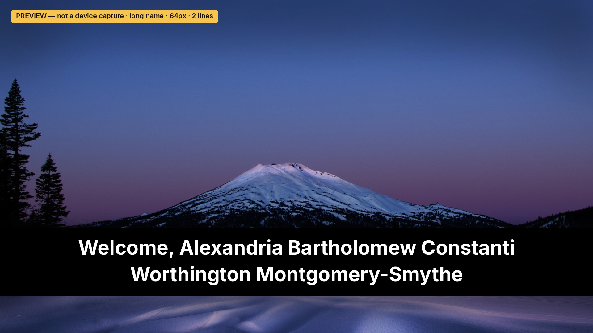

# Eaglewood

A sideloaded Roku SceneGraph guest guide for the Eaglewood vacation rental in Sunriver, Oregon. The background is a 1920×1080 photograph of Mt. Bachelor. The left rail is Home, House Rules, Quick Fixes, Things to Do, Dining, Hiking, Book Direct, Checkout, and Wi-Fi. Home opens on a Book Direct strip. Things to Do, Dining, and Hiking are photo cards sorted by the Pacific season. Wi-Fi joins from a worker QR. Book Direct is a flyer with a QR to the house site.

On launch, and again when ECP relaunches the app, the screen shows **Welcome to Eaglewood** immediately. A background task then requests the current guest. When that request succeeds and the stay is still current, the greeting becomes **Welcome, \<firstName\> \<lastName\>**. A missing or invalid last name is left off, so the line is **Welcome, \<firstName\>**. An invalid first name keeps **Welcome to Eaglewood** even if the last name is fine. The launch does not wait on the network (`network_not_required=1`). A second task loads the house guide. Until that returns, the shell uses a short built-in copy of the rules and checkout lines.

The debug port (telnet port 8085) prints `Eaglewood:` lines. Guest lines cover the greeting, the UI resolution, and each step of the guest request: the task was created and started, whether a path key was loaded and its length, the request URL with that key replaced by `***`, the response code, a failure reason, a short body snippet, the parse result, the stay decision (`missing`, `current`, `past`, or `unreadable`), and why a request was skipped. The path key itself is never printed. A failure reason that contains the request address is masked the same way. Guide lines are listed in the TV checklist below. Guide and checkout bodies are not printed.

## Guest document

The live request is:

`GET https://sunrivertownhome.com/tv/<GUEST_PATH_KEY>/guest.json`

`<GUEST_PATH_KEY>` is a secret path segment. This repository is public, so the key is never committed and the scripts never print it. The channel source keeps the base address `https://sunrivertownhome.com/tv/` as one constant, in `GuestServiceOrigin()`. At package time, `scripts/package.sh` (which `scripts/deploy.sh` and the PowerShell scripts call) writes `channel/components/secrets.brs` into the zip only. That file is gitignored. It returns the key to the task node, which is the scope that performs the request. An empty key means the request is skipped and the fallback greeting stays up.

The body is JSON:

```json
{"firstName": "Ada", "lastName": "Lovelace", "checkout": "2026-10-28T11:00:00-07:00"}
```

`checkout` from the worker is a Pacific calendar date, `2026-10-28`, and the worker sends `{}` once that Pacific day has passed. A date alone means the end of that day in America/Los_Angeles: midnight at the start of the next Pacific day. The TV's timezone setting is not used. The channel reads `YYYY-MM-DD` with `Mid` and `Val` and turns that midnight into Unix seconds with day counts plus the US daylight rule (second Sunday in March through the day before the first Sunday in November). That midnight is 07:00 UTC the next morning during daylight time and 08:00 UTC during standard time. A date-only string is never passed to `roDateTime`. A full timestamp is split the same way: the wall clock is converted directly, and a `Z` or numeric offset is applied by arithmetic, so the channel does not depend on a lenient date parser. A timestamp with no zone is UTC. The name is shown while now is strictly before a checkout that parsed. A missing checkout still shows a valid name. A checkout that cannot be read, including a year outside 2000–2037, also shows the name, because the worker already drops a guest after that Pacific day. Only a checkout that parses and is already past uses the fallback. Years after 2037 do not fit the 32-bit second count, so they stay unreadable instead of wrapping into the past.

Each name part is trimmed. Curly apostrophes and dashes are normalized. The part is kept only when every character is a letter (including Latin-1 and Latin Extended-A, except × and ÷), hyphen, apostrophe, space, or period, and at least one character is a letter. Internal spaces collapse to one. Each part is capped at 32 characters. `{}`, a timeout, a non-200 response, or any other failure leaves **Welcome to Eaglewood**.

Long greetings use the label's own wrap, two lines maximum, inside the 1132px home column. The face is `font:LargeBoldSystemFont`, stepping to `font:MediumBoldSystemFont`, `font:SmallBoldSystemFont`, and `font:SmallestBoldSystemFont` when the character length no longer fits. The choice uses length times a per-size character width. There is no Font node and no runtime glyph measurement. The greeting is drawn with a system font name on the Label `font` field before any other layout runs.

## Photograph

| | |
| --- | --- |
| Title | Mt. Bachelor, Oregon, early morning |
| Author | Bonnie Moreland |
| Source | https://www.flickr.com/photos/icetsarina/51934339709/ |
| License | [Public Domain Mark 1.0](https://creativecommons.org/publicdomain/mark/1.0/) (Flickr license id 10) |
| Commons file | https://commons.wikimedia.org/wiki/File:Mt._Bachelor,_Oregon,_early_morning_-_Flickr_-_Bonnie_Moreland_(free_images).jpg |

Checked on the Flickr photo page (schema.org `license` is the Public Domain Mark, and the photo model `"license":10`) and on the Commons file page (`{{PD-author-FlickrPDM}}`, reviewed by Ruthven on 2022-04-19, `AttributionRequired` false). The Public Domain Mark is not a copyright license and does not require attribution or a CREDITS file. The credit is recorded here anyway. The splash images and home-screen icons are crops of the same photograph, with the word Eaglewood drawn on the icons.

`scripts/build_images.py` rebuilds `channel/images` from that file. The packaged JPEGs are baseline (not progressive) and the whole zip stays under the 4 MB certification limit.

## Layout

The channel is FHD (`ui_resolutions=fhd`, `rsg_version=1.3`). The photograph is full screen. Readable text stays inside the FHD title-safe area (1534×866 starting at 192,106). The rail and tiles are focusable chrome inside that same area. Focus is an amber outline or amber fill (`#F2A93B`). The scene keeps remote focus itself; child nodes are not focusable, and if focus ever leaves the scene it is put back.

The left rail is Home, House Rules, Quick Fixes, Things to Do, Dining, Hiking, Book Direct, Checkout, Wi-Fi. Home shows the greeting, a checkout line (guest date when the stay is current, the checkout time, and the quiet-hours rule), a cream Book Direct strip, and six tiles: Wi-Fi, Things to Do, Dining, Hiking, Quick Fixes, Checkout. Focus starts on the strip. Down moves to the tiles. Up from the top tile row returns to the strip. OK on the strip opens Book Direct.

House Rules is the `houseRules` list plus the check-in and check-out times. Quick Fixes is a list of issues and a numbered step card. The Wi-Fi how-to is left off that list so the password is not repeated there; the router step can still appear on the Wi-Fi screen. Checkout is `checkout.json` `summary` and `steps`, the guest's date when the stay is current, and the host name, email, and phone when the live guide has them. Dining, Hiking, and Things to Do are a three-column photo grid sorted for the current America/Los_Angeles season (`seasonRank`, lower first, then source order). Nothing is hidden for being out of season. OK opens the place, with a QR labeled "Website / menu" only when that place has a `url`. Book Direct is the cream and forest flyer. Its large QR and the corner badge both caption `sunrivertownhome.com`. The badge QR encodes `bookDirect.bookingUrl` (`https://book.sunrivertownhome.com`) and sits bottom-right on every screen except Book Direct. Wi-Fi shows the worker QR plus the network name and password. The footer is the site domain and "Book your next stay direct", and it is hidden on Book Direct.

Back from a place returns to its grid, then to the rail, then to Home, then out of the app. Left does the same, except Left on the Home rail does not exit. Right or OK on the rail opens that section. On Quick Fixes, Up and Down change the issue. Right opens step scrolling when more than four steps are loaded. Left returns from the steps to the list. Back from either returns to the rail. The Home key always leaves the app; the channel cannot intercept it. There is no web view, no video, no in-app payment, and no launch of other apps.

Ten minutes without a keypress returns to Home with the Book Direct strip focused. The greeting stays whatever the latest guest fetch decided. Guide and Wi-Fi refresh on their own every six hours.

`splash_min_time=0` so the splash (the same photograph) gives way as soon as the scene is up.

## House guide

Public files, fetched on a Task node with `roUrlTransfer`, `common:/certs/ca-bundle.crt`, and `InitClientCertificates()`:

- `https://sunrivertownhome.com/data/guide.json`
- `https://sunrivertownhome.com/data/checkout.json`
- `https://sunrivertownhome.com/data/activities.json`

The task sends the stored ETag as `If-None-Match`. A 200 is written to `cachefs:/eaglewood/` and the registry section `EaglewoodGuide` stores `etag`, `version`, and `fetchedAt`. A 304 keeps the cache file. If the network fails, the task uses that cache, then `pkg:/data/guide.json`, `pkg:/data/checkout.json`, and `pkg:/data/activities.json`, then a few built-in sentences. The scene paints the packaged or cached copy as soon as the task can read it, then replaces it if the network returns a newer body. A guide without `bookDirect` uses the built-in flyer, including "up to about 10% less". Relative image and QR paths resolve against `https://sunrivertownhome.com`. Posters use `imageTvUrl` when it is JPEG or PNG, otherwise a JPEG or PNG `imageUrl`, otherwise `pkg:/images/tv-placeholder.jpg`. WebP, AVIF, and GIF are not loaded. A place with no `url` gets no QR. `affiliateUrl` is ignored. Two cards may share an activity id; the grid keys them by source index.

Wi-Fi is separate, and only when the package has a path key:

- `GET https://sunrivertownhome.com/tv/<GUEST_PATH_KEY>/wifi.json` with `ssid` and `password`
- `GET https://sunrivertownhome.com/tv/<GUEST_PATH_KEY>/wifi.png`

A 404 or any other failure without a saved copy falls back to the troubleshooting text. A 503 with an empty body and no saved copy shows **Wi-Fi details coming soon**. A saved copy is kept across a 503. The device may store that copy under `cachefs:/eaglewood/`. The registry stores the ETag and fetch time only. The password is never printed and is never written into a committed file. An empty path key skips the request and logs `wifi skip reason=no-key`.

`scripts/package.sh` downloads the public JSON while it builds the zip. Guide and checkout are the unmodified live bodies when those downloads succeed. Activities are replaced only when the live file is version 4 with `/images/tv/*.jpg` posters; otherwise the zip keeps the committed version 4 snapshot. The same bytes are copied to `dist/snapshot/`, which git ignores. `wifi.json` is never downloaded into the zip. The committed fallback scrubs `host.phone` to null and replaces troubleshooting steps that carry a password or a combination with a note to look in the house. The live guide is what puts the phone on Checkout. No phone number, Wi-Fi password, or PIN is written in source, tests, or this README.

`python3 scripts/guide_snapshot.py --check` parses the committed files and refuses a phone number, a password line, a combination, or a Wi-Fi file under `channel/data/`. `python3 scripts/guide_snapshot.py --write-sanitized` refreshes that fallback from the live URLs and will not replace a version 4 activities file or a `bookDirect` block with an older live file. Do not commit the package-time snapshot.

## Developer mode

On the Roku remote: Home, Home, Home, Up, Up, Right, Left, Right, Left, Right. Choose **Enable installer and restart**, set a developer password, and note the IP address. That password is `ROKUPASS`. It is not stored in this repo. After the restart the TV stays in developer mode. The installer page is `http://<ip>/`.

Only one sideloaded app fits on a device. Installing this one replaces whatever dev app was there. Sideloading the same `build_version` fails with an identical-version error. Bump `build_version` in `channel/manifest` when the package changes.

The house TV address used by the scripts is `192.168.86.101`.

## Deploy

`GUEST_PATH_KEY` is the secret path segment from above. Export it in the shell. Do not write it into a file in this repo.

```bash
git pull
export ROKUPASS='the-password-set-on-the-tv'
export GUEST_PATH_KEY
export ROKU_IP=192.168.86.101   # optional; this is the default
./scripts/deploy.sh
```

Without `GUEST_PATH_KEY`, packaging exits nonzero and says the key is not set. Two explicit exceptions skip the key:

```bash
./scripts/deploy.sh --no-guest
./scripts/deploy.sh --stub "http://<lan-ip>:8765/guest.json"
```

`--no-guest` packages an empty key, so the device never requests a guest document and the fallback greeting remains. `--stub` packages a development URL and does not embed `GUEST_PATH_KEY`, even if that variable is set. The stub server speaks HTTP on port 8765 and ignores the cache-busting query:

```bash
python3 scripts/stub-guest.py
```

Use the machine's LAN address in `--stub`, not `127.0.0.1`, so the TV can reach it. The sample body is a fictional guest, Alex Rivera, with a checkout in 2037.

`scripts/package.sh` zips a staged copy of `channel/` with `manifest` at the root of the archive (Roku rejects a zip that wraps the channel in a folder). The generated `components/secrets.brs` is added in that copy. A `secrets.brs` left in the working tree is not what gets packaged, and git ignores it. `scripts/deploy.sh` uploads the zip to `http://$ROKU_IP/plugin_install` as user `rokudev` with HTTP digest. The password is written to a mode-0600 curl config file and is not passed on the curl command line. The script prints **Install Success** or the device's failure text, and exits non-zero on failure. HTTP 401 means the password or developer mode is wrong.

PowerShell, same flags and environment variables:

```powershell
$env:ROKUPASS = 'the-password-set-on-the-tv'
# Set $env:GUEST_PATH_KEY in this session only. Do not save it.
.\scripts\deploy.ps1
.\scripts\deploy.ps1 --no-guest
.\scripts\deploy.ps1 --stub "http://<lan-ip>:8765/guest.json"
```

Do not leave the key in a PowerShell profile or a committed script. `scripts/package.ps1` builds the zip on its own if you only want the archive.

`scripts/check_tracked_guest_key.py` runs from packaging and from `scripts/validate.py`. It uses `git grep` and fails if a tracked file contains a concrete `sunrivertownhome.com/tv/<segment>/guest.json` URL, a key-like string returned from channel code, or a tracked `secrets.brs`. A short word of only letters is not treated as a key. A Roku color constant (`0x` plus eight hex digits, and nothing else) is not treated as a key. Hex without that prefix, a longer token, or any other mix of letters, digits, and `.` `_` `~` `-` still is. The documentation form with angle brackets is not a match. The check prints file names, not the matching line.

## Check-in launch

Hubitat turns the TV on and starts the app over ECP. The commands, Fast TV start, Control by mobile apps, and a note on Guest Mode are in [docs/ECP.md](docs/ECP.md). A relaunch while the app is open fetches the guest document and the guide again and returns to Home.

## If this is published later

Sideloading does not go through certification. A public listing would. The manifest already sets `rsg_version=1.3`, FHD and HD icons (540×405 and 290×218), and FHD, HD, and SD splash images. The app subscribes to `roAppMemoryMonitor` warnings. In the Developer Dashboard, set the package's minimum firmware to 15.1.0 or greater. That minimum is a dashboard field, not a manifest key. The title does not contain "Roku". Bump the version for every package. The path key is injected at package time and is not part of the git history. Guest names are not in the package. This repo has not been submitted, and the Design & UX guidelines and the pre-certification checklist were not used as a review pass.

## TV checklist

On the house TCL (`192.168.86.101`), after `git pull`, `export ROKUPASS` and `GUEST_PATH_KEY`, and `./scripts/deploy.sh`:

1. The script prints **Install Success**. Launch the sideloaded channel (Hubitat/ECP `POST /launch/dev`, or OK on the dev tile).
2. Home shows the Mt. Bachelor photo, the left rail, **Welcome, \<name\>** when the worker has a current guest, otherwise **Welcome to Eaglewood**. The line under the greeting includes the checkout time and quiet hours. The cream **Book direct & save** strip has the amber focus. The footer reads `sunrivertownhome.com · Book your next stay direct` (the domain comes from the guide). A small **Book direct** badge sits bottom-right once its QR loads. The caption under that QR is `sunrivertownhome.com`.
3. Down and Right move among the six tiles. Up from Wi-Fi returns to the strip. The amber outline moves with the remote. It does not disappear. OK on the strip opens Book Direct.
4. OK on Dining, Hiking, or Things to Do opens a photo grid titled for the Pacific season. OK opens one place. A place with a website shows **This place** / **Website / menu** and its own QR. A place with no `url` shows no QR block. Back returns to the grid, then to the rail. Posters that fail show the bundled placeholder.
5. OK on Wi-Fi shows the join QR, the network name, and the password when `wifi.json` is 200. The caption is not a URL. If the worker returns 503 and this TV has never stored Wi-Fi, the screen says **Wi-Fi details coming soon**. A wrong path key is a 404 and, with nothing stored, falls back to the troubleshooting sentence.
6. OK on Quick Fixes opens the how-to list: issues on the left, numbered steps on the right. Up and Down change the issue. The Wi-Fi issue is not in this list. The log still counts every issue in the file (13 when the current file is loaded). Back returns to the rail.
7. Rail Down to House Rules, then OK or Right. The bullets and the check-in/out times. Back returns to the rail.
8. Checkout, from the rail or the tile: the summary, the steps, and the host name, email, and phone. The phone is whatever `guide.json` sent. It is not baked into the channel source. Book Direct shows the three headlines, the forest banner, the living-room photo, the savings line, and a QR captioned `sunrivertownhome.com`. The corner badge is hidden on this screen.
9. From a section: Back to the rail, Back to Home, Back exits the channel. Left from a section also returns toward the rail. Left on the Home rail does not exit. From a place, Back returns to the grid first.
10. Leave the remote alone for 10 minutes. The channel returns to Home with the Book Direct strip focused. The greeting is unchanged.
11. Optional: disconnect the TV's network and launch again. Rules, checkout, activities, and Book Direct still render from the cache or the packaged snapshot. The footer says **Saved copy**, **Packaged copy**, or **Offline copy**. A fresh network body hides that note. Missing photos use the packaged placeholder. A QR that fails says **Link unavailable offline.**
12. Telnet port **8085**. A clean launch does not print `GetOneLineWidth`, `roFontRegistry`, `layout error`, the path key, the Wi-Fi password, or the SSID value. Guest fetch lines are unchanged (`key loaded`, `url = ` with the path segment as `***`, `response code=`, `checkout decision=current` or `missing` / `past` / `unreadable`). Guide lines, in order:

```text
Eaglewood: screen=home zone=prompt
Eaglewood: guide version=<n> source=pkg code=0
Eaglewood: checkout decision=pkg version=<n> code=0
Eaglewood: activities version=<n> source=pkg code=0
Eaglewood: guide applied source=pkg version=<n> rules=6 issues=13
Eaglewood: host phone present=yes
Eaglewood: checkout applied source=pkg version=<n> steps=2
Eaglewood: activities applied source=pkg version=<n> count=66
Eaglewood: wifi task created generation=1
Eaglewood: wifi task started generation=1
Eaglewood: wifi request sent
Eaglewood: wifi response code=200
Eaglewood: wifi etag stored
Eaglewood: wifi png request sent
Eaglewood: wifi png response code=200
Eaglewood: wifi etag stored
Eaglewood: wifi ssid len=<n>
Eaglewood: wifi png bytes=<n>
Eaglewood: wifi applied source=network ssid len=<n> png=yes
Eaglewood: guide request sent
Eaglewood: guide response code=200
Eaglewood: guide etag stored
Eaglewood: guide version=<n> source=network code=200
Eaglewood: checkout request sent
Eaglewood: checkout response code=200
Eaglewood: checkout etag stored
Eaglewood: checkout decision=network version=<n> code=200
Eaglewood: activities request sent
Eaglewood: activities response code=200
Eaglewood: activities etag stored
Eaglewood: activities version=<n> source=network code=200
Eaglewood: guide applied source=network version=<n> rules=6 issues=13
Eaglewood: host phone present=yes
Eaglewood: checkout applied source=network version=<n> steps=2
Eaglewood: activities applied source=network version=<n> count=66
```

Guest lines and the Wi-Fi lines print at the same time as the guide lines, so they can sit between these. The guide task's own lines stay in this order. `source=pkg` is `cachefs` when this TV already has a cached copy. The stay line `Eaglewood: checkout decision=current` has no `version=`. The content-file line `Eaglewood: checkout decision=network version=<n> code=200` does. On a later launch, a matching ETag prints `response code=304`, `etag match`, and `source=not-modified`. A failed request prints `response code=0` and `failure reason=timeout` (or `http`), and the screen stays on the cache, the package, or the built-in lines. `host phone present=no` means that copy of the guide had an empty phone. The first `present=` line follows the packaged copy; the second follows the live file. While production `activities.json` is still older than version 4, the second activities line keeps the packaged count only when the network body fails to parse; a successful old file replaces the count with whatever that file contains.

Wi-Fi with no path key prints `wifi skip reason=no-key` and never prints `wifi request sent`. A 503 prints `wifi response code=503` and `wifi kept cache=yes` or `wifi kept cache=no`. With no cache the scene line is `wifi applied source=unavailable ssid len=0 png=no`. A 404 with no cache does not print `kept cache`. `wifi ssid len=` is a character count. The SSID and the password are not printed.

Navigation prints `Eaglewood: screen=<section> zone=<rail|tiles|list|panel|detail|prompt|grid|item>`. Home opens with `zone=prompt`. Leaving the app from the Home rail prints `Eaglewood: back exit`. Idle prints `Eaglewood: idle return home`.

## Checks without a Roku

```bash
python3 scripts/validate.py          # manifest, images, greeting, guide snapshot, key check
./scripts/package.sh --no-guest      # zip layout and the 4 MB cap
./scripts/test_guest_package.sh      # key required, injected only into the zip, stub, grep
./scripts/test_deploy.sh             # installer success/failure, password not in curl's argv
npm install
npm run lint                         # bslint and the brighterscript compiler
python3 scripts/render_preview.py    # 1920×1080 previews, including a long name
./scripts/test_brs_greeting.sh       # names, checkout instants, and wrap on the brs interpreter
./scripts/test_brs_phase2.sh         # Pacific seasons, sort, posters, QR, Wi-Fi modes
```

`brs` 0.45 runs the BrightScript greeting and checkout functions. It does not implement SceneGraph (`roSGScreen` is absent), and the `brs-engine` package is not published on npm, so there is no headless render of the channel. The pictures below are the earlier full-bleed greeting studies, drawn from the same JPEG and greeting rules. They are not the Phase 1 rail layout and they are not photographs of the TV.




Still needs the house TV: the checklist above, the real system font, digest install, `PowerOn` with Fast TV start, `POST /launch/dev`, `query/active-app`, relaunch while the app is open, and Guest Mode closing the app.
