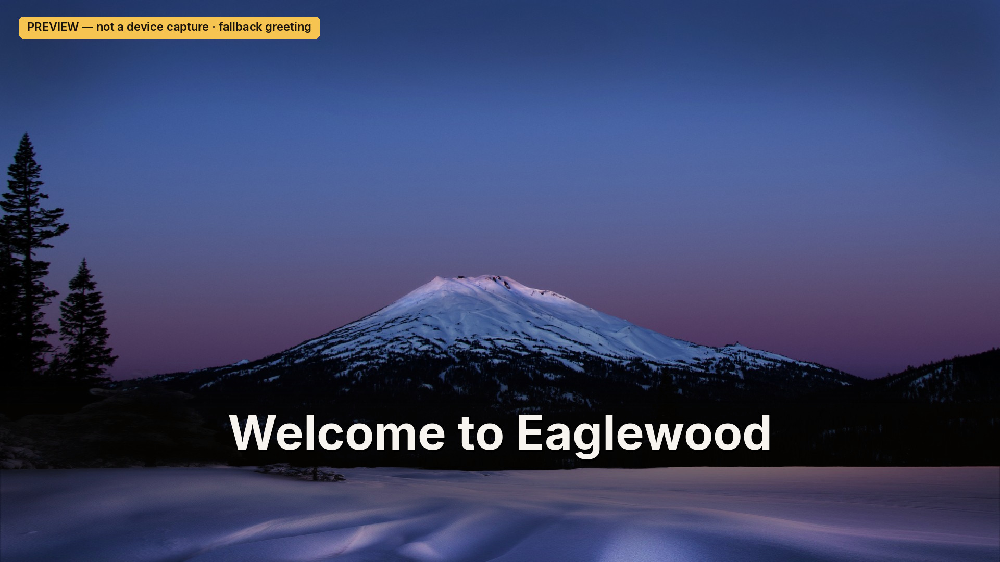
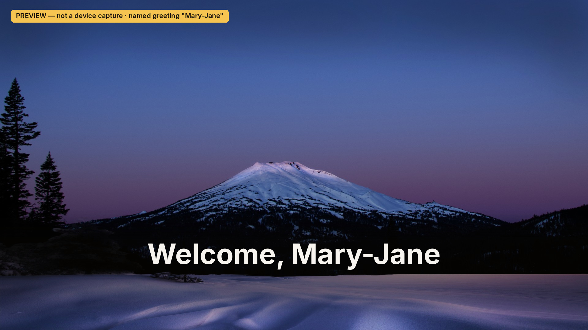

# Eaglewood

A sideloaded Roku SceneGraph welcome screen for the Eaglewood vacation rental in Sunriver, Oregon. It is one screen: a 1920×1080 photograph of Mt. Bachelor and a greeting.

The greeting is **Welcome to Eaglewood** unless a first name is set in the channel. To show **Welcome, Alex**, edit `GuestFirstName()` in `channel/components/MainScene.brs` and sideload again. Leave it as `return ""` for the default. The value is the first word only, at most 20 characters, and only letters, hyphens, and straight apostrophes. Anything else, including an empty string, falls back to **Welcome to Eaglewood**. Do not put a phone number, a door PIN, or a card number in that function.

There is no network fetch in v1. A later version can greet the current guest from a small public `guest.json` (`{"firstName":"..."}`) written by the Pipedream flow that already receives the name from Host Tools. Pipedream would commit that file with the GitHub contents API (token stored in Pipedream) or write it to something like Cloudflare KV. The app would fetch it on each launch, including an ECP relaunch, with a cache-busting query and a short timeout, and fall back when the name is missing or checkout has passed. The file would be public, so it stays a first name only. That wiring is not built.

## Photograph

| | |
| --- | --- |
| Title | Mt. Bachelor, Oregon, early morning |
| Author | Bonnie Moreland |
| Source | https://www.flickr.com/photos/icetsarina/51934339709/ |
| License | [Public Domain Mark 1.0](https://creativecommons.org/publicdomain/mark/1.0/) (Flickr license id 10) |
| Commons file | https://commons.wikimedia.org/wiki/File:Mt._Bachelor,_Oregon,_early_morning_-_Flickr_-_Bonnie_Moreland_(free_images).jpg |

Checked on the Flickr photo page (schema.org `license` is the Public Domain Mark, and the photo model `"license":10`) and on the Commons file page (`{{PD-author-FlickrPDM}}`, reviewed by Ruthven on 2022-04-19, `AttributionRequired` false). The Public Domain Mark is not a copyright license and does not require attribution or a CREDITS file. The credit is recorded here anyway. The splash images and home-screen icons are crops of the same photograph, with the word Eaglewood drawn on the icons.

`scripts/build_images.py` rebuilds `channel/images` from that file. The packaged JPEGs are baseline (not progressive) and the whole zip stays under the 4 MB certification limit.

## Layout

The channel is FHD (`ui_resolutions=fhd`, `rsg_version=1.3`). The photograph is full screen. A short gradient sits behind the greeting so the type stays readable over the trees, and a second copy of the line is offset as a shadow. Back on this screen exits the app. Home always exits; the app cannot intercept it. There is no web view, no video, and no launch of other apps.

Launch does not wait on the network (`network_not_required=1`). `splash_min_time=0` so the splash (the same photograph) gives way as soon as the scene is up.

## Developer mode

On the Roku remote: Home, Home, Home, Up, Up, Right, Left, Right, Left, Right. Choose **Enable installer and restart**, set a developer password, and note the IP address. That password is `ROKUPASS`. It is not stored in this repo. After the restart the TV stays in developer mode. The installer page is `http://<ip>/`.

Only one sideloaded app fits on a device. Installing this one replaces whatever dev app was there. Sideloading the same `build_version` fails with an identical-version error. Bump `build_version` in `channel/manifest` when the package changes.

The house TV address used by the scripts is `192.168.86.101`.

## Deploy

From the repo root, on a machine that can reach the TV:

```bash
export ROKUPASS='the-password-set-on-the-tv'
export ROKU_IP=192.168.86.101   # optional; this is the default
./scripts/deploy.sh
```

`scripts/package.sh` zips `channel/` with `manifest` at the root of the archive (Roku rejects a zip that wraps the channel in a folder). `scripts/deploy.sh` uploads that zip to `http://$ROKU_IP/plugin_install` as user `rokudev` with HTTP digest. The password is written to a mode-0600 curl config file and is not passed on the curl command line. The script prints **Install Success** or the device's failure text, and exits non-zero on failure. HTTP 401 means the password or developer mode is wrong.

PowerShell, same environment variables:

```powershell
$env:ROKUPASS = 'the-password-set-on-the-tv'
.\scripts\deploy.ps1
```

`scripts/package.ps1` builds the zip on its own if you only want the archive.

## Check-in launch

Hubitat turns the TV on and starts the app over ECP. The commands, Fast TV start, Control by mobile apps, and a note on Guest Mode are in [docs/ECP.md](docs/ECP.md).

## If this is published later

Sideloading does not go through certification. A public listing would. The manifest already sets `rsg_version=1.3`, FHD and HD icons (540×405 and 290×218), and FHD, HD, and SD splash images. The app subscribes to `roAppMemoryMonitor` warnings. In the Developer Dashboard, set the package's minimum firmware to 15.1.0 or greater. That minimum is a dashboard field, not a manifest key. The title does not contain "Roku". Bump the version for every package. Content that should change per guest does not belong in the package; see the `guest.json` note above. This repo has not been submitted, and the Design & UX guidelines and the pre-certification checklist were not used as a review pass.

## Checks without a Roku

```bash
python3 scripts/validate.py          # manifest, image sizes, greeting rules
./scripts/package.sh                 # zip layout and the 4 MB cap
./scripts/test_deploy.sh             # installer success/failure, password not in curl's argv
npm install
npm run lint                         # bslint and the brighterscript compiler
python3 scripts/render_preview.py    # 1920×1080 previews
./scripts/test_brs_greeting.sh       # greeting function on the brs interpreter
```

`brs` 0.45 runs the BrightScript greeting function. It does not implement SceneGraph (`roSGScreen` is absent), and the `brs-engine` package is not published on npm, so there is no headless render of the channel. The pictures below are layout previews drawn from the same JPEG, scrim, and `MainScene.xml` coordinates. The typeface is Inter Bold standing in for the Roku system font. They are not photographs of the TV.





Still needs the house TV: sideload, the real system font, Back and Home, digest install, `PowerOn` with Fast TV start, `POST /launch/dev`, `query/active-app`, relaunch while the app is open, and Guest Mode closing the app.
